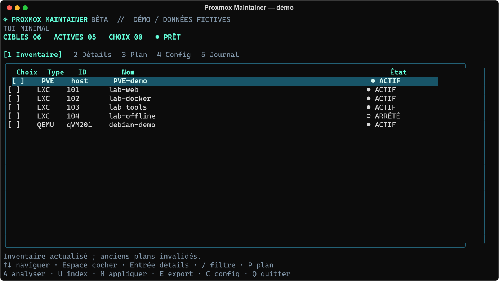
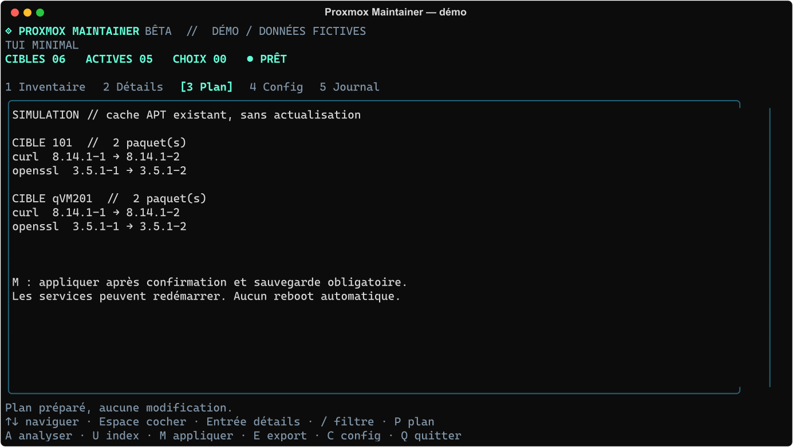

# TUI minimal — bêta

Cette branche porte le prototype personnel vers **Go**, pour distribuer ensuite un binaire autonome. Interface Bubble Tea/Bubbles, styles Lip Gloss, commandes Cobra, configuration JSON. Pas de dépendance Python ni de serveur web.

```bash
go build -o bin/proxmox-maint ./cmd/proxmox-maint
./bin/proxmox-maint --demo
./bin/proxmox-maint                  # PVE local, accès root
./bin/proxmox-maint --host mon-pve    # alias SSH existant
```

Mode réel : Espace sélectionne ; P prépare le plan ; U propose l’actualisation des index ; M demande confirmation avant backup puis application APT. C configure connexion et stockage de backup, Ctrl+S enregistre. E exporte le plan. Les tâches approuvées sont exécutées dans un processus Linux indépendant ; fermer le TUI ne doit pas interrompre APT. Une rupture SSH ou un arrêt système demande néanmoins une vérification humaine.

VM Linux APT : alias SSH root **accessible depuis PVE**, configuré explicitement :

```bash
./bin/proxmox-maint --vm-ssh qVM201=debian-lab
```

Ou conserver le mapping dans `~/.local/state/homelab-maintainer/config.json` :

```json
{"host":"","backup_storage":"MON-BACKUP","vm_ssh":{"qVM201":"debian-lab"}}
```

Les alias sont à vérifier manuellement ; aucune IP ou clé n’est découverte/installée. Sans accès VM configuré, l’invité reste visible avec une raison de refus. Les VM Windows et invités sans APT ne sont pas gérés.

## Captures — données fictives




## Limites actuelles

Interface volontairement minimale et expérimentale. Tests moteur simulés, pas de mise à jour/restauration d’une VM réelle validée. La sauvegarde ne garantit pas la cohérence d’une base ; snapshot VM potentiellement crash-consistent. Aucun hôte PVE, image Docker, dépôt/canal ou snapshot mis à jour. Voir [la feuille de route datée](ROADMAP.md).

Le TUI n’a pas encore d’installation publique automatique ni de commande d’auto-mise à jour. `install.sh` à la racine installe seulement la version **Shell**. Les binaires bêta peuvent être téléchargés dans les releases ; ne pas installer Go sur PVE pour exécuter un binaire déjà compilé.
